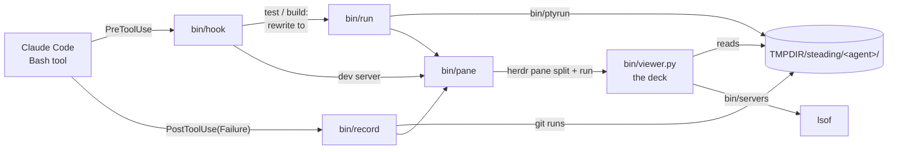

<div align="center">

# Steading

**[herdr](https://herdr.dev) 위에서 돌아가는 에이전트 개발 환경.**

<sub>*steading* (스코틀랜드어): 농가. 살림집과 일하는 건물들을 함께 이르는 말.</sub>

[](LICENSE)
[](https://herdr.dev)
[](https://code.claude.com)

[English](README.md) · **한국어**

</div>

코딩 에이전트는 빌드, 테스트, git 명령을 계속 실행하고 개발 서버도 띄웁니다.
Steading은 이 모든 것을 **에이전트 옆 deck 패널 하나**에 모아 보여 줍니다.
대화를 거슬러 올라가며 찾지 않아도 됩니다.

```
┌ Claude Code ────────────────────────────────────────────┬ Steading ────────────────────────────┐
│                                                         │ SERVERS BUILD ✓ TEST ✗ GIT ✓ DEPLOY  │
│ > run the tests                                         │╭─ runs 2 ───────────────────────────╮│
│                                                         ││> ✗ npm test                 1m ago ││
│ ● I'll run the test suite.                              ││  ✓ npm test                 9m ago ││
│                                                         │╰────────────────────────────────────╯│
│ ● Bash(npm test)                                        │$ npm test                            │
│   └ Tests  1 failed | 23 passed (24)                    │  ~/app  3s  exit 1                   │
│     +18 lines (ctrl+o to expand)                        │──────────────────────────────────────│
│                                                         │ ✓ src/utils.test.ts (12 tests)       │
│ ● One test fails: src/auth.test.ts rejects an expired   │ > src/auth.test.ts (12 | 1 failed)   │
│   token. The expiry check uses < where it needs <=.     │   x rejects an expired token         │
│   Want me to fix it?                                    │ Tests  1 failed | 23 passed (24)     │
│                                                         │                                      │
│                                                         │                                      │
│─────────────────────────────────────────────────────────│                                      │
│ >                                                       │                                      │
│─────────────────────────────────────────────────────────│ »                                    │
│   ? for shortcuts                                       │ j/k select  enter open  q close      │
└─────────────────────────────────────────────────────────┴──────────────────────────────────────┘
```

## 기능

- **deck 하나, 섹션 다섯 개** — `servers`, `build`, `test`, `git`, `deploy`. 탭마다 최근 상태를
  표시합니다(`✓` `✗`, 실행 중이면 스피너, 떠 있는 서버는 `●`).
- **항상 곁에** — herdr가 알아보는 에이전트(Claude Code, Codex, OpenCode 등)가 시작되면 그 옆에
  deck이 열리고, `prefix+d`로 어느 패널 옆에서든 열고 닫을 수 있습니다. 셸을 거치지 않고 패널에서
  바로 시작합니다. Claude Code에는 테스트와 빌드를 단순한 명령으로 실행하라고 알려 주어 deck이
  출력을 실시간으로 보여 줄 수 있게 합니다(세션 컨텍스트에만 추가하고 파일은 고치지 않습니다).
- **에이전트를 따라감** — 에이전트가 테스트, 빌드, git 명령을 실행하거나 개발 서버를 띄우면 deck이
  해당 섹션과 실행 기록으로 넘어갑니다.
- **실시간 컬러 출력** — 빌드와 테스트는 의사 터미널에서 실행되어 셸에서 보던 색 그대로 보입니다.
  에이전트는 여전히 일반 텍스트와 실제 종료 코드를 받습니다.
- **설명 대신 명령** — 실행 기록은 핵심 명령으로 표시됩니다. 에이전트에게 호출 설명을
  `<kind>: <command>` 형식으로 쓰게 하고, 그 밖의 경우는 셸 토큰을 읽어 명령만 남깁니다.
- **모든 deck이 같은 섹션** — 어느 deck에서 섹션을 고르면 열린 deck이 모두 그 섹션으로 바뀝니다.
  스스로 시작된 실행은 자기 deck만 움직입니다.
- **실행 기록** — 섹션마다 실행 목록을 최신순으로 보여 줍니다(최근 20개, git은 50개). `j` `k`나
  클릭으로 고릅니다. 세션을 새 패널에서 다시 열면 대화 기록에서 목록을 복원합니다.
- **herdr 복사 모드 키** — 어떤 로그에서든 커서를 움직이고, 선택하고, 클립보드로 복사하고, 검색합니다.
- **개발 서버** — 프로젝트 안의 프로세스가 연 포트를 보여 줍니다. 클릭하거나 키 하나로 브라우저에서 엽니다.
- **마우스** — 섹션, 실행 목록, 로그 줄, 서버를 클릭하고 휠로 스크롤합니다. 단축키 줄 위의 `»`를
  누르면 deck이 상태 표시만 남은 좁은 세로줄로 접히고, `«`나 상태 표시를 누르면 다시 펼쳐집니다.
- **의존성 없음** — bash, `jq`, 시스템 `python3`만 씁니다.

## 빠른 시작

필요한 것: herdr 0.9+, Claude Code, `jq`, `python3`(macOS와 Linux에 기본으로 있음).

```sh
herdr plugin install levx-me/steading --yes
```

`claude`가 `PATH`에 있으면 herdr 플러그인을 설치할 때 Claude Code 쪽도 함께 설치됩니다.
그다음 열려 있는 Claude Code 세션마다 실행하세요.

```
/reload-plugins
```

새 세션은 따로 할 일이 없습니다. herdr 설치 도구 없이 설치하려면:

```sh
claude plugin marketplace add levx-me/steading
claude plugin install steading@steading
```

## 사용법

따로 시작할 것은 없습니다. 세션이 시작되면 오른쪽에 deck이 열리고 에이전트를 따라갑니다.

| 에이전트가 실행하는 명령 | 섹션 | 처리 방식 |
|---|---|---|
| `npm/pnpm/yarn test[:x]`, `vitest`, `jest`, `pytest`, `go test`, `cargo test`, `bun test`, `deno test`, `forge test`, `make`/`just test`, `./test.sh` 같은 스크립트 | **test** | deck 안에서 실행하고 출력을 돌려줌 |
| `npm/pnpm/yarn run build[:x]`, `tsc`, `next build`, `vite build`, `go build`, `cargo build`/`check`, `forge build`, `make`/`just build`, `./build.sh` 같은 스크립트 | **build** | deck 안에서 실행하고 출력을 돌려줌 |
| 체인이나 파이프 안의 테스트와 빌드(`git status; npm test 2>&1 \| grep FAIL`) | **test** / **build** | 실행이 끝난 뒤 기록 |
| `git …`이 들어 있는 명령 | **git** | 실행이 끝난 뒤 기록(Claude의 권한 확인은 그대로). 커밋은 메시지 전체를 보여 줌 |
| `vercel`, `railway up`, `netlify deploy`, `fly deploy`, `wrangler deploy`, `firebase deploy`, `gcloud run deploy`, `terraform apply`, `kubectl apply`, `helm upgrade`, `forge script --broadcast` 등([전체 목록](bin/classify)) | **deploy** | 실행이 끝난 뒤 기록(권한 확인은 그대로). 상태·로그·목록 조회 명령은 제외 |
| `npm run dev`, `next dev`, `vite`, `anvil`, `uvicorn`, `flask run`, … | **servers** | 명령은 그대로 두고 섹션만 앞으로 가져옴 |

deck 안에서 실시간 컬러로 실행되는 것은 단순한 호출뿐입니다:
`[cd DIR &&] [VAR=val] [time|nice|timeout N|env] [npx|pnpm|…] RUNNER [args]`, 여기에 `2>&1`과
`| tail/head -n N` 하나까지 붙일 수 있습니다. 다른 명령과 이어지거나, 다른 곳으로 파이프되거나,
리다이렉트나 치환을 쓰는 명령은 에이전트가 쓴 그대로 실행되고, 끝난 뒤 deck에 나타납니다.

### 열고 닫기

herdr의 `config.toml`에 키를 추가하세요(에이전트가 시작되면 deck은 저절로 열립니다).

```toml
[[keys.command]]
key = "prefix+d"
type = "plugin_action"
command = "steading.toggle"
```

`prefix+d`는 포커스된 패널 옆에 deck을 열거나 닫습니다. deck 위에서 누르면 그 deck을 닫습니다.
deck이 저절로 열리지 않게 하려면: `touch ~/.config/herdr/plugins/config/steading/no-auto-open`.

### 키

deck에 포커스를 두세요(클릭하거나 herdr의 패널 이동 키 사용). 맨 아래 줄에 지금 쓸 수 있는 키가
항상 표시됩니다.

| 위치 | 키 | 동작 |
|---|---|---|
| 어디서나 | `[` `]`(또는 `tab` `shift+tab`), `1`–`5` | 이전/다음 섹션, 해당 섹션으로 이동 |
| | `q` | deck 닫기 |
| 실행 목록(build, test, git) | `j` `k`, `gg` `G` | 실행 고르기(최신이 위) |
| | `enter` `l` | 출력으로 들어가기 |
| 출력 | `h` `j` `k` `l`, `w` `b` `e`, `W` `B` `E`, `0` `^` `$`, `{` `}` | 커서 이동(herdr 복사 모드 키) |
| | `gg` `G`, `ctrl+d` `ctrl+u` | 맨 위/맨 아래(`G`는 실행 중인 출력을 다시 따라감), 반 페이지 |
| | `v` `V`, `y` | 글자/줄 단위 선택, 복사(선택이 없으면 커서 줄) |
| | `/` `?`, `n` `N` | 앞/뒤로 검색, 반복 |
| | `esc` | 선택 취소, 또는 실행 목록으로 돌아가기 |
| servers | `j` `k`, `enter` `o` | 서버 고르기, 브라우저에서 열기 |

복사는 `pbcopy`, `wl-copy`, `xclip` 순으로 쓰고, 없으면 터미널 클립보드(OSC 52)를 씁니다.

## 구조



- `bin/classify`는 명령줄을 셸 토큰 단위로 읽습니다. 무엇을 실행하는지(test, build, deploy, git 쓰기),
  보여 줄 핵심 명령(`cd x; env -u A pnpm test | tail` → `pnpm test`), 실시간으로 실행해도 되는지를
  판단합니다. 두 훅이 모두 이것을 씁니다.
- `bin/hook`은 Bash 호출이 무엇인지 판단합니다. 테스트와 빌드는 `bin/run`으로 바꿔 실행하고
  (승인됨, 아래 참고), 개발 서버는 deck만 엽니다.
- `bin/run`은 명령을 의사 터미널(`bin/ptyrun`)에서 실행하고, 실행 기록을
  `$TMPDIR/steading/<agent pane>/<kind>/runs/<n>/`에 쓴 뒤, 일반 텍스트 출력과 종료 코드를 돌려줍니다.
- `bin/deck`은 herdr 쪽입니다. `toggle`은 단축키용, `auto`는 herdr의 `pane.agent_detected` 이벤트용입니다.
- `bin/open`은 Claude Code 세션에 단순한 명령으로 실행하라는 안내를 추가합니다.
  세션이 새 패널에서 다시 열렸거나 `/tmp`가 비워져 deck이 비어 있으면, `bin/restore`가 세션 대화
  기록을 `bin/record`에 다시 넣어 deck을 채웁니다.
- `bin/record`는 git 명령, 그리고 `bin/run`을 거치지 않은 테스트와 빌드를 Claude가 실행한 뒤 기록합니다.
- `bin/pane`은 에이전트마다 deck을 한 번 열고(오른쪽으로 분할) 어느 섹션을 보여 줄지 알려 줍니다.
- `bin/viewer.py`는 그 실행 기록 디렉터리로 deck을 그리고, 파일이 수정되면 스스로 다시 시작합니다.

## 설정

| 변수 | 기본값 | 용도 |
|---|---|---|
| `STEADING_SOURCE` | `levx-me/steading` | `bin/install-claude`가 Claude Code 마켓플레이스를 추가할 위치(경로 또는 `owner/repo`) |
| `TMPDIR` | `/tmp` | 실행 기록(`$TMPDIR/steading`)의 상위 디렉터리 |

deck에서 실행되는 명령에는 `CI=1`(watch 모드 끔)과 `FORCE_COLOR=1`, `CLICOLOR_FORCE=1`,
`PY_COLORS=1`, `CARGO_TERM_COLOR=always`가 설정됩니다.

## 보안 참고

- deck으로 넘긴 테스트와 빌드는 Claude Code에 **승인됨**(`permissionDecision: "allow"`)으로 돌려주므로
  권한을 묻지 않습니다. deny와 ask 규칙은 그대로 적용됩니다. `npm test`와 `npm run build`는
  `package.json`에 적힌 것을 그대로 실행합니다. 자동 승인을 원하지 않으면 `bin/hook`의 패턴에서 빼세요.
- git 명령은 Steading이 바꾸거나 승인하지 않습니다.
- 실행 로그는 `$TMPDIR`에만 남고 컴퓨터 밖으로 나가지 않습니다.

## 개발

```sh
git clone git@github.com:levx-me/steading.git && cd steading
claude plugin marketplace add "$PWD" && claude plugin install steading@steading
herdr plugin link "$PWD"
bun test
```

체크아웃한 저장소로 플러그인을 설치하면 `bun test` 자체도 deck에서 실행됩니다.

## 라이선스

[MIT](LICENSE)
