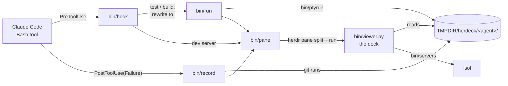

<div align="center">

# Herdeck

**An agentic development environment on top of [herdr](https://herdr.dev).**

[](LICENSE)
[](https://herdr.dev)
[](https://code.claude.com)

</div>

Your coding agent runs builds, tests and git, and starts dev servers, all the time.
Herdeck puts all of that in **one deck pane beside the agent**, so you can follow it
without scrolling back through the conversation.

```
┌ agent ─────────────────────┬ Herdeck ──────────────────────────────────┐
│                            │  1 SERVERS ●  2 BUILD ✓  3 TEST ✗  4 GIT ✓ │
│  > run the tests           │                                           │
│                            │  ✓ bun test  ▎✗ forge test                 │
│                            │ $ forge test · ~/app/contracts · 2s · exit 1│
│  ● Bash(forge test)        │ ──────────────────────────────────────────│
│    ⎿ 2 passed, 1 failed    │ [PASS] test_add() (gas: 144)              │
│                            │ [FAIL: 2 + 2 should be 5] test_broken()   │
└────────────────────────────┴───────────────────────────────────────────┘
```

## Features

- **One deck, four sections** — `servers`, `build`, `test`, `git`, each tab showing
  the latest status (`✓` `✗` `⋯` `●`).
- **Follows the agent** — when the agent runs a test, a build or a git command, or
  starts a dev server, the deck opens (if needed) and switches to that section and run.
- **Live, coloured output** — builds and tests run on a pseudo-terminal, so you see
  the colours you would in a shell; the agent still gets plain text and the real exit code.
- **Run history** — every run is a tab inside its section (the last 20, git the last 50).
- **herdr copy-mode keys** — move a cursor over any log, select, yank to the clipboard, search.
- **Dev servers** — ports opened by processes inside the project, clickable, one key
  to open in the browser.
- **Mouse** — click sections, runs, log lines and servers; scroll with the wheel.
- **No dependencies** — bash, `jq` and the system `python3`.

## Quick start

Requirements: herdr 0.9+, Claude Code, `jq`, `python3` (macOS and Linux ship one).

```sh
herdr plugin install levx-me/herdeck --yes
```

Installing the herdr plugin also installs the Claude Code side when `claude` is on
your `PATH`. Then, in every open Claude Code session:

```
/reload-plugins
```

New sessions pick it up on their own. Without herdr's installer:

```sh
claude plugin marketplace add levx-me/herdeck
claude plugin install herdeck@herdeck
```

## Usage

Nothing to start: ask the agent to run your tests and the deck appears on the right.

| The agent runs | Section | How |
|---|---|---|
| `vitest`, `jest`, `pytest`, `cargo test`, `go test`, `bun test`, `deno test`, `forge test`, `npm/pnpm/yarn test` | **test** | runs inside the deck, output handed back |
| `forge build`, `cargo build`/`check`, `go build`, `tsc`, `next build`, `vite build`, `npm run build` | **build** | runs inside the deck, output handed back |
| any command with `git …` | **git** | recorded after it ran (Claude's permission checks unchanged) |
| `npm run dev`, `next dev`, `vite`, `anvil`, `uvicorn`, `flask run`, … | **servers** | command untouched, section brought forward |

Only plain invocations are routed: `[cd DIR &&] [VAR=val] [npx|pnpm|…] RUNNER [args]`,
optionally with `2>&1` and one `| tail/head -n N`. Anything chained, piped elsewhere,
redirected or using substitutions runs exactly as the agent wrote it.

### Keys

Focus the deck (click it, or herdr's pane navigation) and:

| Keys | Action |
|---|---|
| `tab` `shift+tab`, `1`–`4` | switch section |
| `[` `]` | previous / next run in the section |
| `h` `j` `k` `l`, `w` `b` `e`, `W` `B` `E`, `0` `^` `$`, `{` `}` | move the cursor |
| `gg` `G`, `ctrl+d` `ctrl+u` | top / bottom (`G` follows the live run again), half page |
| `v` `V`, `y` | select by character / line, yank (the cursor line when nothing is selected) |
| `/` `?`, `n` `N`, `esc` | search forward / back, repeat, cancel |
| `x`, `q` | drop the run, close the deck |
| servers: `j` `k`, `enter` `o` | pick a server, open it in the browser |

Yanks go to `pbcopy`, `wl-copy` or `xclip`, falling back to the terminal clipboard (OSC 52).

## Architecture



- `bin/hook` decides what a Bash call is. Tests and builds are rewritten to `bin/run`
  (approved, see below); dev servers only open the deck.
- `bin/run` runs the command on a pseudo-terminal (`bin/ptyrun`), writes the run to
  `$TMPDIR/herdeck/<agent pane>/<kind>/runs/<n>/`, and returns the plain output and exit code.
- `bin/record` keeps git commands after Claude ran them.
- `bin/pane` opens the deck once per agent (split to the right) and tells it which section to show.
- `bin/viewer.py` draws the deck from those run directories and reloads itself when edited.

## Configuration

| Variable | Default | Purpose |
|---|---|---|
| `HERDECK_SOURCE` | `levx-me/herdeck` | Where `bin/install-claude` adds the Claude Code marketplace from (a path or `owner/repo`) |
| `TMPDIR` | `/tmp` | Parent of the run history (`$TMPDIR/herdeck`) |

Commands run in the deck get `CI=1` (no watch modes) and `FORCE_COLOR=1`,
`CLICOLOR_FORCE=1`, `PY_COLORS=1`, `CARGO_TERM_COLOR=always`.

## Security notes

- Routed tests and builds are returned to Claude Code as **approved** (`permissionDecision: "allow"`),
  so they do not ask for permission. Your deny and ask rules still apply. `npm test` and
  `npm run build` run whatever `package.json` says: if you do not want those auto-approved,
  remove them from the patterns in `bin/hook`.
- Git commands are never rewritten or approved by Herdeck.
- Run logs stay in `$TMPDIR`; nothing leaves the machine.

## Development

```sh
git clone git@github.com:levx-me/herdeck.git && cd herdeck
claude plugin marketplace add "$PWD" && claude plugin install herdeck@herdeck
herdr plugin link "$PWD"
bun test
```

With the plugin installed from your checkout, `bun test` itself runs in the deck.

## License

[MIT](LICENSE)
