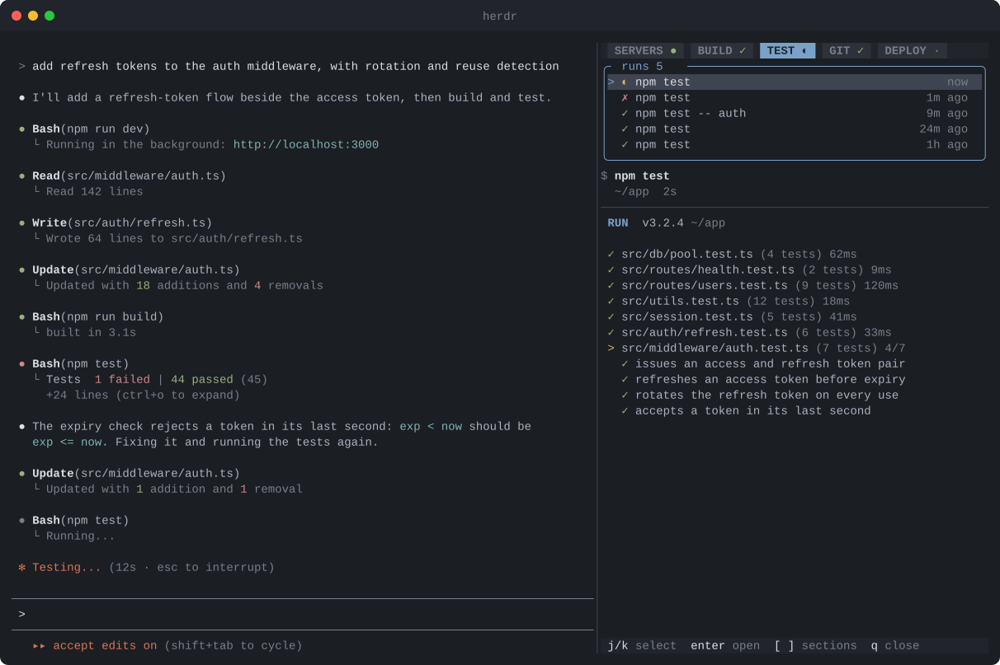
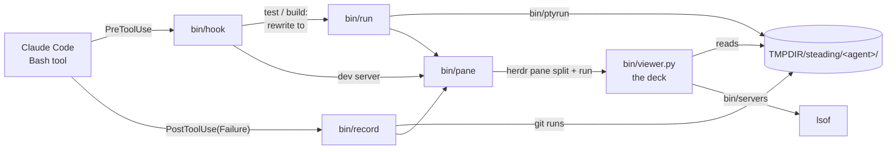

<div align="center">

# Steading

**An agentic development environment on top of [herdr](https://herdr.dev).**

<sub>*steading* (Scots): a farmstead, the house and its working buildings together.</sub>

[](LICENSE)
[](https://herdr.dev)
[](https://code.claude.com)

**English** · [한국어](README.ko.md)

</div>

Your coding agent runs builds, tests and git, and starts dev servers, all the time.
Steading puts all of that in **one deck pane beside the agent**, so you can follow it
without scrolling back through the conversation.



## Features

- **One deck, seven sections** — `agents`, `jobs`, `servers`, `build`, `test`, `git`, `deploy`, each tab
  showing the latest status (`✓` `✗`, a spinner while running, `●` for live servers).
- **Agents** — the agent itself, always on top (its session title and whether it is working,
  waiting on you or idle), and under it each Claude Code subagent at work, background and
  workflow agents too, read from the session's transcripts as
  [zoetrope](https://github.com/furkankly/zoetrope) does.
- **Jobs** — any other command of the agent that takes 10s or more (a wait loop, an install, a
  script with a long timeout) shows up with what it is for (the call's description), how long it
  has run against its timeout, and its output as it comes, read from Claude Code's own output
  file for the call. Nothing about the call changes.
- **Always there** — the deck opens beside any agent herdr recognises (Claude Code, Codex,
  OpenCode, ...) as it starts, and `prefix+d` opens or closes it beside any pane. It starts
  straight in its pane, no shell first. Claude Code is also told to run tests and builds as
  plain commands so the deck can stream them (added to the session's context; no file is edited).
- **Follows the agent** — when the agent runs a test, a build or a git command, or
  starts a dev server, an open deck switches to that section and run. Runs never open a deck you
  closed: they are still recorded, and show when you open it again.
- **Live, coloured output** — builds and tests run on a pseudo-terminal, so you see
  the colours you would in a shell; the agent still gets plain text and the real exit code.
- **Commands, not prose** — each run is listed by its core command: the agent is asked to
  describe calls as `<kind>: <command>`, and anything else is cut down to the command by its shell tokens.
- **One section everywhere** — pick a section in any deck and every open deck switches to it; runs
  that start on their own only move their own deck.
- **Run history** — each section lists its runs, newest on top (the last 20, git the
  last 50); pick one with `j` `k` or a click. A session resumed in a new pane gets its list
  back from the transcript.
- **Repository at a glance** — the git list's border shows the branch, commits not pushed (`↑2`)
  or not pulled (`↓1`), and how many files are not committed (or `clean`).
- **herdr copy-mode keys** — move a cursor over any log, select, yank to the clipboard, search.
- **Dev servers** — ports opened by processes inside the project, or started from any pane of
  its herdr workspace (the agent's `pnpm dev` in a sibling app counts), each with its log: the
  file it writes to, or the herdr pane it prints in. One key opens it in the browser.
- **Mouse** — click sections, runs in the list, log lines and servers; scroll with the wheel (over the run list it moves
  through the runs); drag over a log to select and copy it, as in herdr.
- **No dependencies** — bash, `jq` and the system `python3`.

## Quick start

Requirements: herdr 0.9+, Claude Code, `jq`, `python3` (macOS and Linux ship one).

```sh
herdr plugin install levx-me/steading --yes
```

Installing the herdr plugin also installs the Claude Code side when `claude` is on
your `PATH`. Then, in every open Claude Code session:

```
/reload-plugins
```

New sessions pick it up on their own. Without herdr's installer:

```sh
claude plugin marketplace add levx-me/steading
claude plugin install steading@steading
```

## Usage

Nothing to start: the deck opens on the right when a session starts, and follows the agent.

| The agent runs | Section | How |
|---|---|---|
| `npm/pnpm/yarn test[:x]`, `vitest`, `jest`, `pytest`, `go test`, `cargo test`, `bun test`, `deno test`, `forge test`, `make`/`just test`, `./test.sh`-style scripts | **test** | runs inside the deck, output handed back |
| `npm/pnpm/yarn run build[:x]`, `tsc`, `next build`, `vite build`, `go build`, `cargo build`/`check`, `forge build`, `make`/`just build`, `./build.sh`-style scripts | **build** | runs inside the deck, output handed back |
| tests and builds inside chains or pipes (`git status; npm test 2>&1 \| grep FAIL`) | **test** / **build** | recorded after they ran |
| any command with `git …` | **git** | recorded after it ran (Claude's permission checks unchanged); a commit shows its whole message |
| `vercel`, `railway up`, `netlify deploy`, `fly deploy`, `wrangler deploy`, `firebase deploy`, `gcloud run deploy`, `terraform apply`, `kubectl apply`, `helm upgrade`, `forge script --broadcast`, ... ([full list](bin/classify)) | **deploy** | recorded after it ran (permission checks unchanged); status, logs and list commands stay out |
| `npm run dev`, `next dev`, `vite`, `anvil`, `uvicorn`, `flask run`, … | **servers** | command untouched, section brought forward |

Only plain invocations run inside the deck (live, coloured):
`[cd DIR &&] [VAR=val] [time|nice|timeout N|env] [npx|pnpm|…] RUNNER [args]`, optionally with `2>&1` and one
`| tail/head -n N`. Anything chained, piped elsewhere, redirected or using substitutions
runs exactly as the agent wrote it, and shows up in the deck once it has finished.

### Open and close

Add a key in herdr's `config.toml` (the deck opens on its own when an agent starts):

```toml
[[keys.command]]
key = "prefix+d"
type = "plugin_action"
command = "steading.toggle"
```

`prefix+d` opens the deck beside the focused pane, or closes it; on the deck itself it closes that
deck. It opens to the right of the agent, or on top of it when the agent pane is too narrow for a
deck beside it (under 140 columns); `L` in the deck moves it. A closed deck stays closed until you open it. To stop decks opening when an agent starts: `touch ~/.config/herdr/plugins/config/steading/no-auto-open`.

### Keys

Focus the deck (click it, or herdr's pane navigation). The bottom row always shows
the keys that apply right now.

| Where | Keys | Action |
|---|---|---|
| anywhere | `[` `]` (or `tab` `shift+tab`), `1`–`7` | previous / next section, jump to one |
| | `q` | close the deck |
| | `L` | move the deck to the other side of the agent (right or on top); that agent's deck stays there |
| run list (agents, jobs, servers, build, test, git) | `j` `k` (or `↓` `↑`), `gg` `G` | pick a run (newest on top) |
| | `enter` `l` | move into its output |
| output | `h` `j` `k` `l`, `w` `b` `e`, `W` `B` `E`, `0` `^` `$`, `{` `}` | move the cursor (herdr copy-mode keys) |
| | `gg` `G`, `ctrl+d` `ctrl+u` | top / bottom (`G` follows the live run again), half page |
| | `v` `V`, `y` | select by character / line, yank (the cursor line when nothing is selected) |
| | `/` `?`, `n` `N` | search forward / back, repeat |
| | `esc` | cancel the selection, or back to the run list |
| servers | `j` `k`, `enter` `l`, `o` | pick a server, move into its log (same keys as output), open it in the browser |

Arrow keys work as `h` `j` `k` `l` everywhere. While the cursor is in the list, the run's command and log
are drawn faint; moving into the log turns that around. Yanks and drag-selections go to `pbcopy`, `wl-copy` or `xclip`, falling back to the terminal clipboard (OSC 52).

## Architecture



- `bin/classify` reads a command line by its shell tokens: what it runs (test, build, deploy, git write), the
  core command to show (`cd x; env -u A pnpm test | tail` → `pnpm test`), and whether it may run live. Both hooks use it.
- `bin/hook` decides what a Bash call is. Tests and builds are rewritten to `bin/run`
  (approved, see below); dev servers only bring an open deck to `servers`; anything else is
  filed as a job, and `bin/job` finds Claude Code's output file for it once it starts.
- `bin/run` runs the command on a pseudo-terminal (`bin/ptyrun`), writes the run to
  `$TMPDIR/steading/<agent pane>/<kind>/runs/<n>/`, and returns the plain output and exit code.
- `bin/deck` is the herdr side: `toggle` for the key, `auto` for herdr's `pane.agent_detected` event.
- `bin/open` adds the run-it-plainly note to a Claude Code session.
  When the session is resumed in a new pane (or `/tmp` was cleared) and its deck is empty,
  `bin/restore` refills the deck from the session transcript, through `bin/record`.
- `bin/record` keeps git commands, and tests and builds that were not routed, after Claude ran them.
- `bin/pane` opens the deck once per agent (split to the right) and tells it which section to show;
  with `--follow` (runs) it only switches a deck that is already open.
- `bin/viewer.py` draws the deck from those run directories and reloads itself when edited.

## Configuration

| Variable | Default | Purpose |
|---|---|---|
| `STEADING_SOURCE` | `levx-me/steading` | Where `bin/install-claude` adds the Claude Code marketplace from (a path or `owner/repo`) |
| `TMPDIR` | `/tmp` | Parent of the run history (`$TMPDIR/steading`) |

Commands run in the deck get `CI=1` (no watch modes) and `FORCE_COLOR=1`,
`CLICOLOR_FORCE=1`, `PY_COLORS=1`, `CARGO_TERM_COLOR=always`.

## Security notes

- Routed tests and builds are returned to Claude Code as **approved** (`permissionDecision: "allow"`),
  so they do not ask for permission. Your deny and ask rules still apply. `npm test` and
  `npm run build` run whatever `package.json` says: if you do not want those auto-approved,
  remove them from the patterns in `bin/hook`.
- Git commands are never rewritten or approved by Steading.
- Run logs stay in `$TMPDIR`; nothing leaves the machine.

## Development

```sh
git clone git@github.com:levx-me/steading.git && cd steading
claude plugin marketplace add "$PWD" && claude plugin install steading@steading
herdr plugin link "$PWD"
bun test
```

With the plugin installed from your checkout, `bun test` itself runs in the deck.

## License

[MIT](LICENSE)
